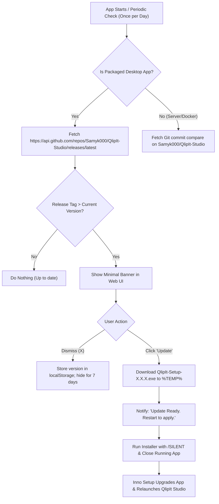

# QlipIt Studio — Architecture, Rebranding & V1.1 Roadmap

> **Document Version**: 1.1.0  
> **Status**: Living Architectural Specification & Contributor Guide  
> **Target Repository**: [https://github.com/Samyk000/QlipIt-Studio.git](https://github.com/Samyk000/QlipIt-Studio.git) (`main` branch)  
> **Author/Maintainer**: QlipIt Studio Core Team  

---

## 1. Executive Overview & Product Identity

**QlipIt Studio** is an open-source, privacy-first desktop application and server for turning long videos and live streams into captioned vertical clips (9:16) optimized for YouTube Shorts, Instagram Reels, and TikTok.

### Core Capabilities
1. **Intelligent Moment Detection**:
   - Transcribes audio locally using on-device neural ASR (`sherpa-onnx` + Parakeet 0.6b TDT).
   - Queries Bring-Your-Own-Key (BYOK) AI providers (Google Gemini, OpenAI, Grok, Groq, OpenRouter, Anthropic, or local Ollama) to analyze transcript structure, emotional peaks, hook potential, and punchiness.
   - Falls back gracefully to audio loudness/speech envelope analysis if no AI provider is configured.
2. **Neural Voiceover Studio**:
   - Preview voice actors, generate AI narration scripts, adjust cadence, and burn synchronized voiceover directly into clips with automatic ducking of original background audio.
3. **Automated Layouts & Captions**:
   - Video transformation into 9:16 aspect ratios (smart crop, split camera/gameplay, or blurred fill).
   - Three animated caption styles rendered via Libass and custom SIL-licensed fonts (`Anton`, `Archivo Black`, `Poppins`).
4. **Live Stream Highlight Buffer**:
   - Connects to RTMP/HLS streams (Twitch, Kick, YouTube) to clip highlights in real time while the broadcast continues.
5. **Multi-Platform Publishing**:
   - Direct OAuth integrations with YouTube Data API v3, Instagram Graph API, and TikTok Direct Post API with automated queue pacing.

---

## 2. Independence & Rebranding Verification

The application is completely severed from any upstream source repository:
- **Git History**: Fresh root repository initialized directly on `main` and pushed to `https://github.com/Samyk000/QlipIt-Studio.git`.
- **Zero Third-Party Upstream Tracking**: No remotes, branches, or hooks connect to `haziqahmedqasmi/PeakCut`.
- **Packaging & Executables**:
  - Windows application build spec: `desktop/qlipit.spec`
  - Inno Setup installer spec: `desktop/qlipit.iss` (produces `QlipIt-Setup-1.0.0.exe`)
  - Mutex identifier: `QlipItAppMutex`
  - Local AppData storage: `%LOCALAPPDATA%\QlipIt`
- **Configuration & Backwards Compatibility**:
  - Primary environment variables use the `QLIPIT_*` namespace (`QLIPIT_DATA`, `QLIPIT_PORT`, `QLIPIT_AI_*`, etc.).
  - `studio/config.py` provides transparent dual-resolution: `QLIPIT_*` values are read first, with seamless fallback to legacy variables so zero existing installations or scripts break.
- **Test Integrity**: All 17 automated test suites (350+ individual checks in `tests/run.py`) pass 100% green.

---

## 3. Installed App vs. Source Code (Build Immutability)

### How the Installed Windows App Works
When you build QlipIt Studio via `powershell -File desktop\build.ps1`:
1. PyInstaller packages Python, all library binaries, fonts, and web assets into `desktop\dist\QlipIt\`.
2. Inno Setup bundles this folder into a standalone installer (`QlipIt-Setup-1.0.0.exe`).
3. Running the installer places the self-contained executable inside:
   `%LOCALAPPDATA%\Programs\QlipIt\QlipIt.exe`
4. The user data (clips, jobs, database, AI keys, models) is kept strictly inside:
   `%LOCALAPPDATA%\QlipIt\`

### Key Lifecycle Principles
- **Code Edits in the Git Folder Do NOT Affect the Installed App**:
  Editing code inside `c:\Users\...\PeakCut` or your development workspace has **zero impact** on the installed desktop app. The installed app runs from its frozen package in `%LOCALAPPDATA%\Programs\QlipIt\`.
- **Frozen Bundle State**:
  The installed app remains static until you explicitly run a new build and install the updated setup `.exe`.
- **Data Preservation**:
  Reinstalling or upgrading the app leaves all existing clips, jobs, database records, and settings untouched because user data lives in `%LOCALAPPDATA%\QlipIt`, separate from the executable binary folder.

---

## 4. Root Cause: Upstream Update Banner & "Later" Button

### Why the Banner Showed Up
In early versions before our repository wipe:
1. `studio/updates.py` queried GitHub's API comparing the running commit against `haziqahmedqasmi/peakcut/main`.
2. Because the original developer pushed 9 commits, the daemon returned those 9 commits, and `web/index.html` displayed:
   `"A new version of QlipIt is out: 9 updates since yours."`
3. Clicking "How to update" opened a modal directing users to the original author's commits URL (`https://github.com/haziqahmedqasmi/peakcut/commits/main`).

### Why the "Later" Button Failed to Dismiss
1. **Key Mismatch / State Overwrite**: In older frontend revisions, the dismiss token was stored in `localStorage` under `peakcut_update_seen`, whereas the modernized code expected `qlipit_update_seen`.
2. **Polling Desync**: The frontend polls `/api/status` every 5 seconds. If the backend returned an update object with `latest: <sha>` that did not strictly match the saved string, or if dialog cancellation didn't trigger `localStorage.setItem`, the banner was immediately redrawn.
3. **Packaged App Disconnect**: A desktop app user should never be prompted to run `git pull && pip install -r requirements.txt`. That workflow is strictly for server administrators.

---

## 5. V1.1 Roadmap: Minimal Banner & 1-Click Desktop Updater

### What is Feasible vs. Not Feasible on Windows

| Feature | Feasibility | Implementation Details |
|---|---|---|
| **GitHub Releases API Version Check** | **Fully Feasible** | Check `GET https://api.github.com/repos/Samyk000/QlipIt-Studio/releases/latest`. Compare version tag (e.g., `v1.1.0`) against desktop app version (`1.0.0`). |
| **Clean, Minimal UI Banner** | **Fully Feasible** | Non-intrusive pill banner at top right: `✨ QlipIt Studio v1.1.0 is available` with `[Update]` and `[Dismiss (X)]`. |
| **In-App Background Download** | **Fully Feasible** | App downloads `QlipIt-Setup-1.1.0.exe` to `%TEMP%\qlipit-update.exe` with progress bar. |
| **1-Click Automated Upgrade** | **Fully Feasible** | Launch the downloaded installer with flags `/SILENT /CLOSEAPPLICATIONS` and exit the current process. Inno Setup closes the existing window, updates binaries in `%LOCALAPPDATA%\Programs\QlipIt`, and relaunches the app. |
| **In-Place Binary Hot-Patching** | *Not Feasible on Windows* | Windows prevents overwriting running executables and loaded DLLs. Using Inno Setup's silent upgrade mechanism is the native Windows standard. |

### Technical Architecture for v1.1 Update Flow

---

## 6. Codebase Map & Responsibilities

| File / Folder | Primary Responsibility | Rebranding / V1.1 Status |
|---|---|---|
| `studio/server.py` | FastAPI application routing, security headers, rate limiting, and sync gate | Rebranded headers; dual env support |
| `studio/config.py` | Environment variable parsing, dual fallback (`QLIPIT_*` / `PEAKCUT_*`), folder paths | Rebranded defaults; fully backwards-compatible |
| `studio/ai.py` | Unified AI gateway (Gemini, OpenAI, Grok, Groq, OpenRouter, Anthropic, Ollama) | Modernized AI env strings |
| `studio/brain.py` | Prompt engineering: clip identification, hooks, titles, captions, and script analysis | Pure logic; untrusted video text sanitization |
| `studio/voice.py` | Neural voice generation (`edge_tts`), preview synthesis, audio ducking, script polish | Full voice studio integration |
| `studio/updates.py` | Release check engine | Pointed to `Samyk000/QlipIt-Studio` (v1.1 target for Release API) |
| `studio/jobs.py` | Video processing queue, thermal throttling, worker limits, ffmpeg orchestration | Resource caps applied for fan/thermal protection |
| `studio/render.py` | Video cropping, 9:16 layout positioning, Libass subtitle burning | Short temporary folder paths for Windows 260-char safety |
| `web/index.html` | Single-page UI application (HTML, CSS, Vanilla JS, zero build step) | Modernized themes, settings layout, status indicators |
| `desktop/app.py` | Windows native wrapper (edge-based webview, single-instance mutex, taskbar AUMID) | Points to `%LOCALAPPDATA%\QlipIt`, `QlipIt.Studio` |
| `desktop/qlipit.spec`| PyInstaller build blueprint | Bundles Python, ffmpeg, sherpa-onnx, web UI into dist |
| `desktop/qlipit.iss` | Inno Setup Windows installer compiler script | Installs to Program Files/Local AppData; retains user data |
| `tests/run.py` | Master automated test suite (runs 17 test modules) | 100% green verification |

---

## 7. Stability, Scalability & Review Checklist for AI Assistants

When extending or modifying QlipIt Studio, every AI coding assistant MUST verify the following rules:

1. **Dual Resolution Guarantee**:
   Never remove the fallback in `studio/config.py`. Any new setting `QLIPIT_X` should resolve `QLIPIT_X` first, then `PEAKCUT_X`, then default.
2. **Session Context Integrity**:
   Always retrieve the active user via `ctx.uid()`, never from request parameters. When running background tasks, always wrap execution with `ctx.as_user(...)`.
3. **State Sync & Cache Bumping**:
   Any action modifying user state (creating clips, saving AI keys, updating accounts) MUST invoke `ctx.bump()` so `/api/sync` can immediately inform the client UI.
4. **Thermal & Resource Safety**:
   Video transcoding and speech recognition are CPU-intensive. Keep concurrent renders capped (`QLIPIT_MAX_RENDERS`, default 1 on laptops, 2 on desktops) to protect client laptops from fan noise and thermal throttling.
5. **Path Length Guard on Windows**:
   Always render clips in a short temporary directory (`config.TMP_DIR`) before moving to the final directory. Libass / ffmpeg fails on Windows if subtitle path strings exceed 260 characters.
6. **Mandatory Test Verification**:
   Always run `.venv\Scripts\python.exe tests/run.py` before finalizing any modification. All 17 suites must pass cleanly.

---

## 8. Summary of Action Plan for Implementation

When the user gives the instruction to implement V1.1:
1. **Disconnect Git Commit Polling in Desktop Mode**:
   In `studio/updates.py`, switch desktop mode to query the GitHub Releases endpoint (`GET /repos/Samyk000/QlipIt-Studio/releases/latest`) instead of comparing raw git commits.
2. **Minimal Non-Intrusive Banner**:
   Replace the bulky banner in `web/index.html` with a sleek, dismissible notification pill that saves dismiss state reliably to `localStorage.setItem("qlipit_update_seen", release.tag)`.
3. **1-Click Updater Endpoint**:
   Add `/api/updates/install` endpoint on the desktop server to download the setup `.exe` into `%TEMP%` and trigger the silent Inno Setup upgrade.
4. **Re-run Full Tests**: Ensure all automated suites continue to pass.
